<!-- ===== THEME-AWARE ANIMATED TERMINAL HERO ===== -->
<picture>
  <source media="(prefers-color-scheme: dark)" srcset="dark.svg?v=3" />
  <source media="(prefers-color-scheme: light)" srcset="light.svg?v=3" />
  
</picture>

<!-- ===== GITHUB STREAK & ENGINEERING TELEMETRY ===== -->

<picture>
  <source media="(prefers-color-scheme: dark)" srcset="https://streak-stats.demolab.com/?user=andriansyachakbar&hide_border=true&background=0A101F&stroke=22D3EE&ring=F59E0B&fire=10B981&currStreakLabel=22D3EE&sideLabels=94A3B8&currStreakNum=F8FAFC&sideNums=F8FAFC&dates=64748B&titleColor=22D3EE&card_width=1180" />
  <source media="(prefers-color-scheme: light)" srcset="https://streak-stats.demolab.com/?user=andriansyachakbar&hide_border=true&background=FFFFFF&stroke=0891B2&ring=D97706&fire=059669&currStreakLabel=0891B2&sideLabels=475569&currStreakNum=0F172A&sideNums=0F172A&dates=94A3B8&titleColor=0891B2&card_width=1180" />
  
</picture>

 

<picture>
  <source media="(prefers-color-scheme: dark)" srcset="stats-dark.svg" />
  <source media="(prefers-color-scheme: light)" srcset="stats-light.svg" />
  
</picture>

<!-- ===== CONTRIBUTION SNAKE ===== -->

<picture>
  <source media="(prefers-color-scheme: dark)" srcset="https://raw.githubusercontent.com/andriansyachakbar/andriansyachakbar/output/snake-dark.svg" />
  <source media="(prefers-color-scheme: light)" srcset="https://raw.githubusercontent.com/andriansyachakbar/andriansyachakbar/output/snake-light.svg" />
  
</picture>

 

<!-- ===== FEATURED SYSTEMS & PROJECTS PANEL ===== -->

<picture>
  <source media="(prefers-color-scheme: dark)" srcset="projects-dark.svg" />
  <source media="(prefers-color-scheme: light)" srcset="projects-light.svg" />
  
</picture>

 

<!-- ===== CONNECT BAR ===== -->

<a href="mailto:andriansyachakbar@gmail.com"><picture><source media="(prefers-color-scheme: dark)" srcset="footer-dark.svg" /><source media="(prefers-color-scheme: light)" srcset="footer-light.svg" /></picture></a>

