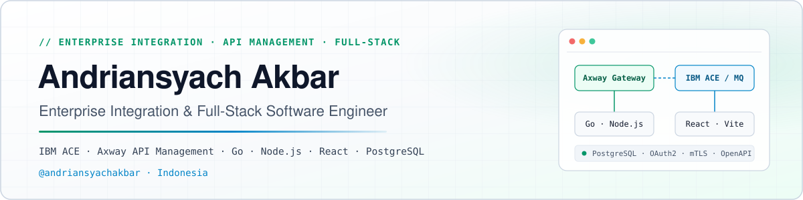
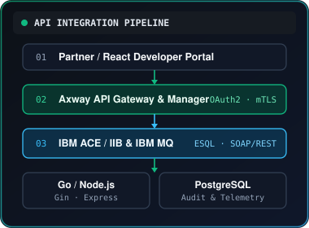

  <picture>
    <source media="(prefers-color-scheme: dark)" srcset="art/header-dark.svg" />
    
  </picture>

<h1 align="center">Hey there, I'm Andriansyach Akbar</h1>

  

  
  
  

 

<h2 align="center">About Me</h2>

<table align="center">
  <tr>
    <td width="64%" valign="top">
      <ul>
        <li>🔧 <strong>Enterprise Integration &amp; Full-Stack Engineer</strong> based in Indonesia, specializing in high-reliability API ecosystems and developer platforms.</li>
        <li>🔀 Architecting middleware orchestration &amp; message flows with <strong>IBM App Connect Enterprise (IBM ACE / IIB)</strong> and <strong>IBM MQ</strong>.</li>
        <li>🛡️ Governing API lifecycle, security policies, OAuth 2.0 / JWT / mTLS, and traffic throttling via <strong>Axway API Management</strong> (API Gateway, API Manager &amp; Policy Studio).</li>
        <li>⚙️ Building full-stack services, Open API portals, and observability dashboards with <strong>Go (Gin)</strong>, <strong>Node.js (Express)</strong>, <strong>React</strong>, and <strong>PostgreSQL</strong>.</li>
        <li>🔒 Security-first mindset: parameterized SQL queries, RBAC &amp; BOLA/IDOR guards, Nginx hardening, structured logging, and automated testing.</li>
        <li>🤝 Open to collaborating on <strong>API Architecture</strong>, <strong>Enterprise Middleware</strong>, and <strong>Developer Tooling</strong>.</li>
      </ul>
    </td>
    <td width="36%" align="center" valign="middle">
      
    </td>
  </tr>
</table>

 

<h2 align="center">Enterprise Integration &amp; API Management</h2>

  
  
  
  
  
  
  
  
  

| Domain | Core Capabilities &amp; Technical Focus |
| :--- | :--- |
| **Middleware &amp; ESB (`IBM ACE / IIB`)** | Message Flow orchestration, ESQL transformations, REST / SOAP / XML / JSON protocol mediation, IBM MQ asynchronous messaging, fault-tolerant error handling, and audit trails. |
| **API Governance &amp; Gateway (`Axway API Management`)** | End-to-end API Gateway &amp; API Manager lifecycle, Policy Studio custom routing/security policies, OAuth 2.0 / JWT / API Key / mTLS enforcement, quota &amp; rate limiting, threat protection, and Developer Portal exposure. |
| **API Security &amp; Observability** | OWASP API Security practices, parameterized queries (anti-SQLi), RBAC &amp; BOLA/IDOR guards, Nginx reverse-proxy hardening, structured logging, and real-time transaction analytics. |

 

<h2 align="center">Tech Stack</h2>

  

  
  
  
  
  
  
  
  

 

<h2 align="center">Selected Engineering Highlights</h2>

| Project | Stack | Highlights |
| :--- | :--- | :--- |
| **Open API Developer Portal &amp; Sandbox** *(Private)* | `Go` · `Gin` · `PostgreSQL` · `React 19` · `Vite` · `Tailwind CSS v4` | Interactive API catalog, stateful sandbox playground, API key management, JWT/RBAC auth, IP rate limiting, and bilingual i18n UI. |
| **Transaction &amp; API Log Monitoring Dashboard** *(Private)* | `Node.js` · `Express` · `Sequelize` · `PostgreSQL` · `React` · `Recharts` | Real-time observability dashboard tracking top applications &amp; endpoints, success vs error rates, multi-filter log search, and JSON request/response inspection. |
| **Enterprise API Gateway &amp; Integration Pipelines** *(Enterprise)* | `IBM ACE` · `IBM MQ` · `Axway API Management` | High-reliability enterprise service mediation, policy governance, protocol transformation, and secure gateway integrations. |

 

<h2 align="center">GitHub Analytics</h2>

  

  

 

  <picture>
    <source media="(prefers-color-scheme: dark)" srcset="https://raw.githubusercontent.com/andriansyachakbar/andriansyachakbar/output/github-contribution-grid-snake-dark.svg" />
    <source media="(prefers-color-scheme: light)" srcset="https://raw.githubusercontent.com/andriansyachakbar/andriansyachakbar/output/github-contribution-grid-snake.svg" />
    
  </picture>

 

<h2 align="center">Let's Connect</h2>

  
  

  Building reliable APIs, one commit at a time.

