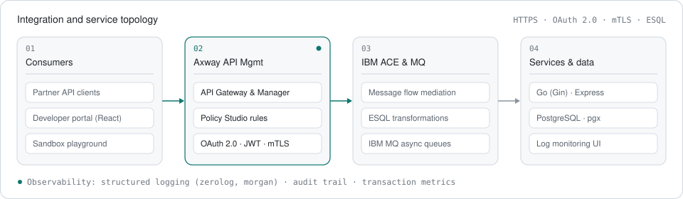

### Enterprise integration, API governance, and full-stack systems

Software engineer based in Indonesia working across enterprise middleware, API management gateways, and full-stack web services. Focused on connecting core enterprise services with modern developer platforms using IBM App Connect Enterprise (ACE), Axway API Management, Go, Node.js, React, and PostgreSQL.

<picture>
  <source media="(prefers-color-scheme: dark)" srcset="art/architecture-dark.svg" />
  <source media="(prefers-color-scheme: light)" srcset="art/architecture-light.svg" />
  
</picture>

### Core capabilities

| Area | Stack and technical focus |
| :--- | :--- |
| **Middleware and ESB** | `IBM ACE / IIB`, `IBM MQ` — message flow orchestration, ESQL transformations, REST and SOAP/XML mediation, asynchronous queue processing, fault-tolerant error handling, and audit trails |
| **API management** | `Axway API Gateway`, `API Manager`, `Policy Studio` — API lifecycle governance, custom routing and security policies, OAuth 2.0, JWT, API key, and mTLS enforcement, quota and rate limiting, threat protection, and developer portal publishing |
| **Backend and data** | `Go` (`Gin`, `pgx`, `zerolog`, `jwt`), `Node.js` (`Express`, `Sequelize`), `PostgreSQL`, `SQLite`, `Nginx` reverse-proxy configuration, and retention-managed logging |
| **Frontend and testing** | `React` (18/19), `Vite`, `Tailwind CSS`, `Zustand`, `Recharts`, `i18next`, `go test`, `Vitest`, and `oxlint` / `ESLint` |
| **Security and hardening** | Parameterized SQL queries, RBAC and object-level ownership checks (BOLA/IDOR), IP and identity rate limiting, login brute-force guards, OWASP security headers, and strict secret isolation |

### Selected systems

- **Open API Developer Portal and Sandbox** *(private)* — Full-stack developer portal built with `Go` (`Gin`, `pgx`, `PostgreSQL`) and `React 19` (`Vite`, `Tailwind CSS`). Includes an interactive API catalog, stateful sandbox endpoints, self-service API key management, JWT/RBAC administration, layered IP and identity rate limiters, and bilingual UI.
- **Transaction and API Log Monitoring Dashboard** *(private)* — Observability application built with `Node.js` (`Express`, `Sequelize`, `PostgreSQL`) and `React` (`Recharts`, `Zustand`). Tracks top applications and endpoints, daily/weekly/monthly success vs error rates, multi-criteria log search, and JSON request/response inspection.
- **Enterprise API Gateway and Integration Pipelines** *(enterprise)* — Service mediation, protocol transformation, and gateway policy enforcement across `IBM ACE`, `IBM MQ`, and `Axway API Management`.

### Contact

Email: [andriansyachakbar@gmail.com](mailto:andriansyachakbar@gmail.com) · Location: Indonesia
